<div align="center">




<p>
  <a href="https://zk-portfolio-seven.vercel.app/"></a>
  <a href="https://www.instagram.com/zk_1980p?igsh=MTlzaDV3a2NubWEwNA==" target="_blank"></a>
  <a href="https://www.linkedin.com/in/azka-zakiyyan-2926863b1" target="_blank"></a>
  
</p>


</div>

## 👋 About Me

I'm a developer who enjoys building things across the web, games, and mobile apps — and I love combining them into interactive web experiences, small games, mobile apps, and 3D visuals.

```ts
const azka = {
  name: "Azka Zakiyyan",
  location: "Bandung, Indonesia 🇮🇩",
  studying: "Informatics @ Universitas Al-Ghifari",
  areas: ["Web", "Games", "Mobile", "3D Art"],
  currentlyDeepening: ["Laravel", "Godot"],
};
```

<div align="center">

</div>

## 🚀 What I Do

<div align="center">

</div>

<div align="center">

</div>

## 🛠️ Tech Stack

<div align="center">
<a href="https://skillicons.dev">
  
</a>
</div>

<div align="center">

</div>

## 📊 GitHub Stats

<div align="center">
  
  
</div>

<div align="center">
  
</div>

<div align="center">
  
</div>

<div align="center">

</div>

## 📌 Featured Projects

<div align="center">
  <a href="https://github.com/Azka3/gallery-informatika"></a>
  <a href="https://github.com/Azka3/zk-portfolio"></a>
  <a href="https://github.com/Azka3/jadwal-produktif"></a>
  <a href="https://github.com/Azka3/headline-maker"></a>
</div>

<p align="center">
  🖼️ <a href="https://gallery-informatika.vercel.app/">Gallery Informatika — live demo</a>
  &nbsp;·&nbsp;
  🌐 <a href="https://zk-portfolio-seven.vercel.app/">My portfolio</a>
  &nbsp;·&nbsp;
  📂 <a href="https://github.com/Azka3?tab=repositories">All repositories</a>
</p>

<div align="center">

</div>

## 🤝 Let's Connect

Feel free to say hi, share ideas, or collaborate on something fun.

<p align="center">
  <a href="https://www.instagram.com/zk_1980p?igsh=MTlzaDV3a2NubWEwNA==" target="_blank"></a>
  <a href="https://www.linkedin.com/in/azka-zakiyyan-2926863b1" target="_blank"></a>
</p>


