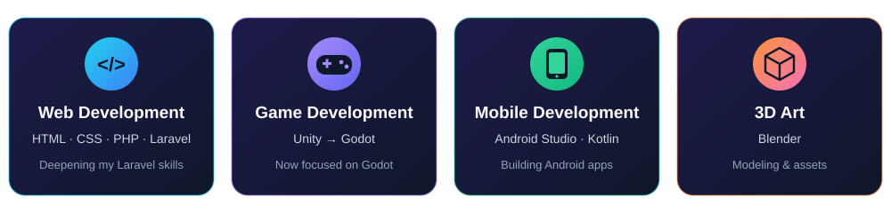
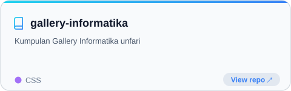
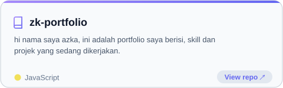
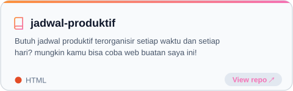
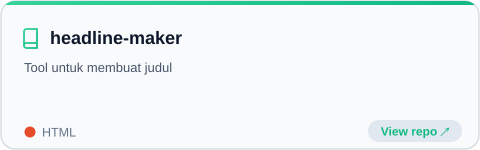

<div align="center">


<p>
  <a href="https://zk-portfolio-seven.vercel.app/"></a>
  <a href="https://www.instagram.com/zk_1980p?igsh=MTlzaDV3a2NubWEwNA==" target="_blank"></a>
  <a href="https://www.linkedin.com/in/azka-zakiyyan-2926863b1" target="_blank"></a>
  
</p>


</div>

## 👋 About Me

I'm a developer who enjoys building things across the web, games, and mobile apps — and I love combining them into interactive web experiences, small games, mobile apps, and 3D visuals.

```ts
const azka = {
  name: "Azka Zakiyyan",
  location: "Bandung, Indonesia 🇮🇩",
  studying: "Informatics @ Universitas Al-Ghifari",
  areas: ["Web", "Games", "Mobile", "3D Art"],
  currentlyDeepening: ["Laravel", "Godot"],
};
```

<div align="center">

</div>

## 🚀 What I Do

<div align="center">

</div>

<div align="center">

</div>

## 🛠️ Tech Stack

<div align="center">
<picture>
  <source media="(prefers-color-scheme: dark)" srcset="https://skillicons.dev/icons?i=html%2Ccss%2Cphp%2Claravel%2Creact%2Cunity%2Cgodot%2Ckotlin%2Candroidstudio%2Cflutter%2Cblender&perline=11&theme=dark">
  <source media="(prefers-color-scheme: light)" srcset="https://skillicons.dev/icons?i=html%2Ccss%2Cphp%2Claravel%2Creact%2Cunity%2Cgodot%2Ckotlin%2Candroidstudio%2Cflutter%2Cblender&perline=11&theme=light">
  
</picture>
</div>

<div align="center">

</div>

## 📊 GitHub Stats

<p align="center">
  <picture>
    <source media="(prefers-color-scheme: dark)" srcset="https://github-readme-stats.vercel.app/api?username=Azka3&show_icons=true&rank_icon=github&custom_title=Azka%27s%20GitHub%20Stats&border_radius=14&bg_color=0f172a&border_color=30363d&title_color=22d3ee&text_color=cbd5e1&icon_color=a78bfa&ring_color=22d3ee">
    <source media="(prefers-color-scheme: light)" srcset="https://github-readme-stats.vercel.app/api?username=Azka3&show_icons=true&rank_icon=github&custom_title=Azka%27s%20GitHub%20Stats&border_radius=14&bg_color=f8fafc&border_color=d0d7de&title_color=7c3aed&text_color=334155&icon_color=0891b2&ring_color=7c3aed">
    
  </picture>
  <picture>
    <source media="(prefers-color-scheme: dark)" srcset="https://github-readme-stats.vercel.app/api/top-langs/?username=Azka3&layout=compact&custom_title=Most%20Used%20Languages&border_radius=14&bg_color=0f172a&border_color=30363d&title_color=22d3ee&text_color=cbd5e1">
    <source media="(prefers-color-scheme: light)" srcset="https://github-readme-stats.vercel.app/api/top-langs/?username=Azka3&layout=compact&custom_title=Most%20Used%20Languages&border_radius=14&bg_color=f8fafc&border_color=d0d7de&title_color=7c3aed&text_color=334155">
    
  </picture>
</p>

<p align="center">
  <picture>
    <source media="(prefers-color-scheme: dark)" srcset="https://streak-stats.demolab.com?user=Azka3&border_radius=14&background=0f172a&border=30363d&stroke=30363d&ring=22d3ee&fire=fb923c&currStreakNum=f8fafc&sideNums=f8fafc&currStreakLabel=22d3ee&sideLabels=cbd5e1&dates=94a3b8">
    <source media="(prefers-color-scheme: light)" srcset="https://streak-stats.demolab.com?user=Azka3&border_radius=14&background=f8fafc&border=d0d7de&stroke=d0d7de&ring=7c3aed&fire=f97316&currStreakNum=0f172a&sideNums=0f172a&currStreakLabel=7c3aed&sideLabels=475569&dates=64748b">
    
  </picture>
</p>

<p align="center">
  <picture>
    <source media="(prefers-color-scheme: dark)" srcset="https://github-readme-activity-graph.vercel.app/graph?username=Azka3&custom_title=Contribution%20Graph&area=true&hide_border=true&radius=14&bg_color=0f172a&color=22d3ee&line=a78bfa&point=f8fafc&area_color=a78bfa&title_color=22d3ee">
    <source media="(prefers-color-scheme: light)" srcset="https://github-readme-activity-graph.vercel.app/graph?username=Azka3&custom_title=Contribution%20Graph&area=true&hide_border=true&radius=14&bg_color=f8fafc&color=7c3aed&line=7c3aed&point=0891b2&area_color=7c3aed&title_color=7c3aed">
    
  </picture>
</p>

<div align="center">

</div>

## 📌 Featured Projects

<p align="center">
  <a href="https://github.com/Azka3/gallery-informatika"></a>
  <a href="https://github.com/Azka3/zk-portfolio"></a>
</p>
<p align="center">
  <a href="https://github.com/Azka3/jadwal-produktif"></a>
  <a href="https://github.com/Azka3/headline-maker"></a>
</p>

<p align="center">
  🖼️ <a href="https://gallery-informatika.vercel.app/">Gallery Informatika — live demo</a>
  &nbsp;·&nbsp;
  🌐 <a href="https://zk-portfolio-seven.vercel.app/">My portfolio</a>
  &nbsp;·&nbsp;
  📂 <a href="https://github.com/Azka3?tab=repositories">All repositories</a>
</p>

<div align="center">

</div>

## 🤝 Let's Connect

Feel free to say hi, share ideas, or collaborate on something fun.

<p align="center">
  <a href="https://www.instagram.com/zk_1980p?igsh=MTlzaDV3a2NubWEwNA==" target="_blank"></a>
  <a href="https://www.linkedin.com/in/azka-zakiyyan-2926863b1" target="_blank"></a>
</p>


